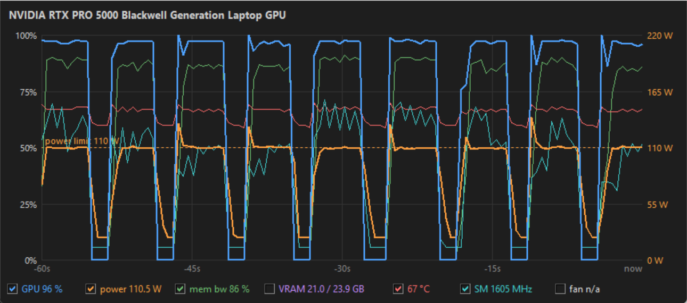

# Wattch

**A tiny live monitor for NVIDIA GPUs: one small window, one graph, nothing to install.**

Wattch graphs GPU use, power draw, memory-bandwidth use, VRAM, temperature, SM clock and fan speed from `nvidia-smi`, live. It's a single Python file that uses only the standard library (tkinter).



## Why

Task Manager's GPU graphs often don't show CUDA work, such as a local LLM running in LM Studio or Ollama. They can sit near 0% while the GPU is flat out. Wattch reads `nvidia-smi` directly, so you see what the card is actually doing.

It also shows the **power limit**, which is how this tool came about.

### Your laptop GPU may be running at half power

On a laptop, the GPU's power limit is set by the laptop's power mode, not just by the chip. In the screenshot above, the card can take up to 175 W and the laptop maker's default is 115 W. With Windows on *Balanced* and the maker's thermal profile on a quiet setting, it was **capped at 55 W**. Under load, the GPU showed ~100% use, but its clock sat at 225–900 MHz instead of up to ~3,000 MHz.

Switching Windows to **Best performance** and the maker's thermal app to its performance profile raised the cap to 110 W. A local vision model describing photos went from **~12 s to ~8 s per photo, about 1.5× faster**. The cost is more fan noise and heat.

If Wattch's power line is pinned flat against the dashed **power limit** line while GPU use is ~100%, your GPU is power-capped. Check your power mode.

## Requirements

- An NVIDIA GPU with the driver installed (`nvidia-smi` on your PATH)
- Python 3.8+ with tkinter, which the python.org installers include on Windows. On Linux you may need `python3-tk`.

Tested on Windows 11 with an RTX PRO 5000 Blackwell laptop GPU. It should work anywhere `nvidia-smi` and tkinter do.

## Run

```
python wattch.py
```

On Windows, `pythonw wattch.py` runs it without a console window.

| Option | Default | Meaning |
|---|---|---|
| `--interval MS` | 500 | Sample interval in milliseconds |
| `--seconds N` | 120 | How much history the graph shows |

Example: `python wattch.py --interval 1000 --seconds 300`

## Reading the graph

| Series | Color | Axis | Shown by default |
|---|---|---|---|
| GPU use | blue | left, % | yes |
| Power draw | orange | right, W | yes |
| Memory-bandwidth use | green | left, % | yes |
| VRAM used | purple | left, % of total (readout in GB) | no |
| Temperature | red | left, °C read directly off the 0–100 scale | no |
| SM clock | cyan | left, % of the card's max SM clock (readout in MHz) | no |
| Fan | white | left, % | no |

- Each checkbox under the graph shows that series' current value in its line color. Untick it to hide the line.
- The **watts axis is fixed** from 0 to the card's maximum power limit + 15%, rounded up. A stray bad reading can't blow up the scale.
- The **dashed orange line** marks the power limit currently enforced, when it's lower than the card's maximum. It's read once at startup, so restart Wattch after changing your power mode.
- Many laptops report the fan as `n/a`. The fan is controlled by the laptop, not the GPU.

## How it works

Wattch starts one long-running `nvidia-smi --query-gpu=... -lms <interval>` process and draws each CSV line it prints on a tkinter canvas. Closing the window stops `nvidia-smi`. On a laptop it used about 2.5% of one CPU core and ~63 MB of RAM, including `nvidia-smi`.

Only the first GPU is shown.

## License

[MIT](LICENSE)
